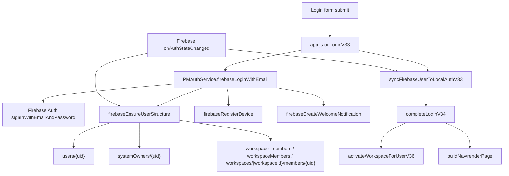

# Auth Current Flow

## 목적
현재 프로젝트의 로그인, 세션, 워크스페이스, 권한 흐름을 코드 변경 없이 분석한 문서입니다.

## 실행 구조 요약
현재 실제 화면은 React 앱이 아니라 정적 compat 앱입니다.

- 진입점: `index.html`
- 화면/상태 중심: `app.js`
- Firebase compat 어댑터: `services/firebaseRuntime.js`
- 인증 보조: `services/authService.js`
- 시스템 관리자/승인/복구: `services/systemAdminService.js`
- 워크스페이스 데이터 실시간 동기화: `services/workspaceDataService.js`
- 초대코드: `services/invitationService.js`
- 로컬 세션/기기/알림 facade: `services/sessionService.js`, `services/deviceService.js`, `services/notificationService.js`
- 공통 역할/권한: `shared/roles.js`, `shared/permissions.js`, `shared/navigation.js`

`src/` 아래 React/TypeScript 구조는 존재하지만 현재 `index.html`에서 로드되지 않습니다. `tsconfig.json`은 `src`만 검사하고, `npm run build`는 `tsc --noEmit && vite build` 후 정적 파일을 `dist`로 복사하는 구조입니다.

## index.html 로딩 순서
`index.html`은 다음 순서로 앱을 로드합니다.

1. `/pm-env.js`
2. Firebase compat CDN
3. `shared/*.js`
4. `services/*.js`
5. `app.js`

따라서 현재 운영 화면에서 먼저 고쳐야 할 런타임 흐름은 `app.js + services/*.js`입니다. React 구조는 병행 작성할 수 있지만, 기존 UI가 React로 연결되기 전까지 사용자 화면에는 반영되지 않습니다.

## 현재 로그인 흐름
현재 정적 앱의 이메일 로그인은 다음 흐름입니다.

1. `app.js`의 `onLoginV33(event)`
2. Firebase 설정이 있으면 `window.PMAuthService.firebaseLoginWithEmail(email, password)`
3. `services/authService.js`의 `firebaseLoginWithEmail`
4. Firebase Auth `signInWithEmailAndPassword`
5. 같은 함수 안에서 `firebaseEnsureUserStructure`
6. 같은 함수 안에서 `firebaseRegisterDevice`
7. 같은 함수 안에서 `firebaseCreateWelcomeNotification`
8. `app.js`에서 `syncFirebaseUserToLocalAuthV33`
9. `completeLoginV34(user)`
10. `activateWorkspaceForUserV36`
11. `PMSessionService.startSession`
12. `PMDeviceService.registerLoginDevice`
13. `buildNav`
14. `renderPage`

Google 로그인도 동일하게 `firebaseLoginWithGoogle` 안에서 Firebase Auth 로그인 후 `firebaseEnsureUserStructure`, 기기 등록, 환영 알림 생성까지 실행합니다.

## 현재 자동 로그인 흐름
`app.js`에는 여러 버전의 `restoreFirebaseSessionV34` 재정의가 누적되어 있습니다. 최종 V93 재정의는 대략 다음 흐름입니다.

1. `PMFirebaseRuntime.init()`
2. `runtime.sdk.auth.onAuthStateChanged(runtime.auth, callback)`
3. Firebase user가 없으면 현재 firebase 사용자 상태에 따라 `logout`
4. 이미 `currentUser`가 있으면 return
5. `PMAuthService.firebaseEnsureUserStructure(firebaseUser, ..., "pending")`
6. `PMAuthService.firebaseRegisterDevice(firebaseUser)`
7. `syncFirebaseUserToLocalAuthV33`
8. `completeLoginV34(user)`

즉 로그인 버튼 경로와 `onAuthStateChanged` 경로 모두에서 세션 보강과 부가 작업을 수행합니다.

## 현재 로그아웃 흐름
정적 앱의 `logout` 함수는 패치 버전별로 여러 번 재정의되어 있습니다. 최종 흐름은 다음 요소를 포함합니다.

- 관리자 전용 임시 인증 상태 제거
- Firebase Auth `signOut`
- local auth 상태의 `currentUserId` 제거
- workspace/store 세션 상태 제거
- `PMSessionService.endCurrentSession`
- `sessionStorage`의 `pm-current-user` 제거
- 로그인 화면 표시

다만 Firebase Auth persistence가 `LOCAL`로 설정되어 있어, Firebase 세션과 앱 내부 세션의 경계가 명확하지 않으면 자동 로그인처럼 보이는 현상이 생길 수 있습니다.

## firebaseEnsureUserStructure 역할
`services/authService.js`의 `firebaseEnsureUserStructure`는 현재 너무 많은 책임을 가집니다.

- `users/{uid}` 읽기
- `systemOwners/{uid}` 읽기
- 누락된 `users/{uid}` 생성
- `workspace_members`에서 활성 멤버십 탐색
- pending/disabled/rejected 상태 갱신
- nested member와 root member 읽기
- role/currentRole/workspaceRole 계산
- `users/{uid}` 업데이트
- 필요 시 `workspace_members`, `workspaceMembers`, `workspaces/{workspaceId}/members/{uid}` 생성/복구

이 함수는 로그인 성공 직후와 자동 로그인 복구 중 모두 호출됩니다. 따라서 Firestore Rules가 약간만 맞지 않아도 로그인 자체가 실패하고, 선택 작업 실패가 인증 실패처럼 보일 수 있습니다.

## 현재 워크스페이스 데이터 동기화 흐름
`services/workspaceDataService.js`는 `start({ workspaceId, store, uid, role, status })` 호출 후 다음을 실행합니다.

- `workspaces/{workspaceId}/settings/app` 구독
- `COLLECTION_KEYS`에 정의된 주요 컬렉션을 모두 구독
- 민감 컬렉션은 role/uid에 따라 쿼리를 제한
- 변경 수신 시 `store[key]` 갱신
- 로컬 변경은 debounce 후 Firestore batch 저장

민감 컬렉션 예:

- `people`
- `friendAwards`
- `penalties`
- `exams`
- `attendance`
- `assignments`
- `lessons`
- `records`
- `portfolios`
- `academicSchedules`
- `studentAccessLogs`

이 구조는 workspaceId가 올바르게 결정된 뒤에만 시작되어야 합니다. 승인 대기, workspace 미연결, 멤버 누락 계정에서 시작되면 Firestore 권한 오류가 발생할 수 있습니다.

## 현재 시스템 관리자 구독 흐름
`services/systemAdminService.js`는 시스템 관리자 화면에서 다음과 같은 전역 구독을 제공합니다.

- `users`
- `workspaces`
- `workspace_members`
- `collectionGroup("members")`
- `workspaceJoinRequests`
- `adminApplications`
- `adminLogs`
- `systemNotices`
- `systemIntegrations`
- `systemIntegrationLogs`

이 구독들은 일반 계정 초기 로딩에서 실행되면 안 됩니다. `system_owner` 또는 허용된 관리자 화면 진입 이후에만 실행되어야 합니다.

## React/TypeScript 전환 구조 현재 상태
`src/`에는 새 구조 일부가 이미 존재합니다.

- `src/lib/firebase.ts`: Firebase modular SDK 초기화
- `src/services/authService.ts`: 이메일 로그인/로그아웃
- `src/services/authAccess.ts`: `loadAppSession`
- `src/context/AuthContext.tsx`: `onAuthStateChanged`와 Auth state
- `src/components/ProtectedRoute.tsx`
- `src/components/guards/RequireAuth.tsx`
- `src/components/guards/RequireWorkspaceRole.tsx`
- `src/services/workspaceService.ts`
- `src/services/workspaceMemberService.ts`
- `src/services/userApprovalService.ts`
- `src/services/memberAdminService.ts`
- `src/services/permissionService.ts`
- `src/services/firestoreSchema.ts`

하지만 아직 다음 문제가 있습니다.

- `src/services/authService.ts`의 `loginWithEmail`이 `signInWithEmailAndPassword` 후 `loadAppSession`을 직접 호출합니다.
- `src/context/AuthContext.tsx`의 `onAuthStateChanged`도 다시 `loadAppSession`을 호출합니다.
- `reloadSession` 실패 시 무조건 `signOut(auth)`를 호출합니다.
- `loadAppSession`은 승인 대기/거절/비활성 사용자를 예외로 던지고, AuthProvider가 이를 로그아웃으로 처리합니다.
- `ProtectedRoute`, `RequireAuth`, `RequireWorkspaceRole`가 공존합니다.
- 요구된 최종 파일명인 `src/auth/*`, `src/workspace/*`, `src/permissions/*`와 현재 파일 위치가 다릅니다.

## 현재 호출 관계 요약

## 핵심 관찰
- Firebase Auth가 인증만 담당하지 않고, 로그인 함수에서 Firestore 사용자 보강과 부가 작업을 함께 실행합니다.
- 세션 생성이 로그인 함수와 `onAuthStateChanged` 양쪽에서 일어납니다.
- `users/{uid}`의 전역 역할과 workspace 멤버 역할이 섞여 있습니다.
- `system_owner`가 `users.role`에도 들어가고, workspace role처럼 취급되는 곳이 있습니다.
- 최종 기준이어야 할 `workspaces/{workspaceId}/members/{uid}` 외에 `workspace_members`, `workspaceMembers`가 여전히 많이 사용됩니다.
- React/TypeScript 구조는 방향은 맞지만 아직 실제 앱과 연결되지 않았고, 새 원칙과 맞지 않는 중복 세션 로딩이 남아 있습니다.
